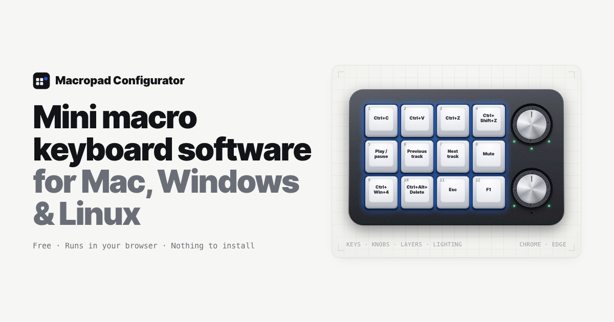

# Macropad Configurator: mini macro keyboard software for Mac, Windows & Linux

A free, open-source configurator for the small CH57x-based macro keyboards with keys and knobs sold on AliExpress and Amazon (the ones that come with `MINI_KEYBOARD.exe`). It runs entirely in the browser over WebHID, so it works on **macOS, Windows, Linux and ChromeOS** with nothing to install.

**Live site:** https://ffrafat.github.io/macropad-configurator/



## Features

- Remap every key, and each knob's turn left, press and turn right
- Shortcuts and macros (up to 18 keys, with an optional delay), recorded straight from your keyboard
- Media and system keys, plus mouse click, scroll, move and drag
- Three layers
- LED lighting: always on, light on press and ripple effects, set per layer
- Export and import setups as JSON
- Layouts: 3 keys + 1 knob, 4, 5 and 6 keys, 6 keys + 1 or 2 knobs, 9 keys + 2 or 3 knobs, 12 keys + 2, 3 or 4 knobs, 15 keys + 3 knobs

## Supported devices

| USB ID | Protocol | Status |
|---|---|---|
| `514C:8851` | 884x | Tested |
| `1189:8840`, `1189:8842`, `1189:8850` | 884x | Supported |
| `1189:8890` | 8890 | Supported |
| `1189:8830`–`8833`, other `514C:88xx` | 884x | Should work |

## Use

1. Plug the pad in with its USB cable.
2. Open the site in **Chrome, Edge, Brave or Opera**. Safari and Firefox don't support WebHID.
3. Click **Connect**, pick a key, choose an action and click **Write**.

On Linux, allow access once:

```bash
echo 'SUBSYSTEM=="hidraw", ATTRS{idVendor}=="1189", TAG+="uaccess"
SUBSYSTEM=="hidraw", ATTRS{idVendor}=="514c", TAG+="uaccess"' | sudo tee /etc/udev/rules.d/70-macropad.rules
sudo udevadm control --reload-rules
```

To preview locally, run the following, then open http://localhost:8765 in Chrome:

```bash
python3 -m http.server 8765 --directory docs
```

## Protocol notes

All configuration goes to the pad's vendor HID interface (usage page `0xFF00`) as output report `3`. The pads can't report their current settings.

**884x family**: reverse-engineered from `MINI_KEYBOARD.exe`:

- Bind: `FE <key> <layer 1-3> <type> 00×5 …`, then `AA AA`, `FD FE FF`, `AA AA`
  - Type `1` keys: `<count> (<mods> <HID code>)…`
  - Type `2` media: `00 <lo> <hi>`
  - Type `3` mouse: `<action> <mod> <buttons> <dx> <dy> <wheel>`
  - Type `5` delay: `<ms lo> <ms hi>`
- LEDs: `FE B0 <layer> 08 00 00 00 00 00 01 00 <color<<4 | mode>`, then `FD FE FF`
- Key ids: buttons `1-15`; knobs `16 + 3·knob + (0 left, 1 press, 2 right)`. A 4th knob on 12-key pads uses `13-15`.

**8890 family**: per [ch57x-keyboard-tool](https://github.com/kriomant/ch57x-keyboard-tool):

- Start: `FE <layer> 01 01`
- Then one message per item: `<key> <layer<<4 | type> …`
- Finish: `AA AA`
- Key ids: buttons `1-12`; knobs `13 + 3·knob + action`

## Not affiliated

This is an independent project. It isn't affiliated with or endorsed by any macro keyboard maker or seller.
